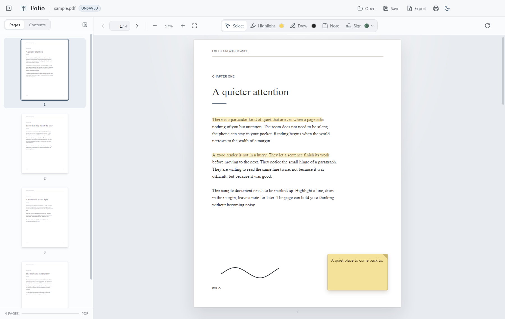
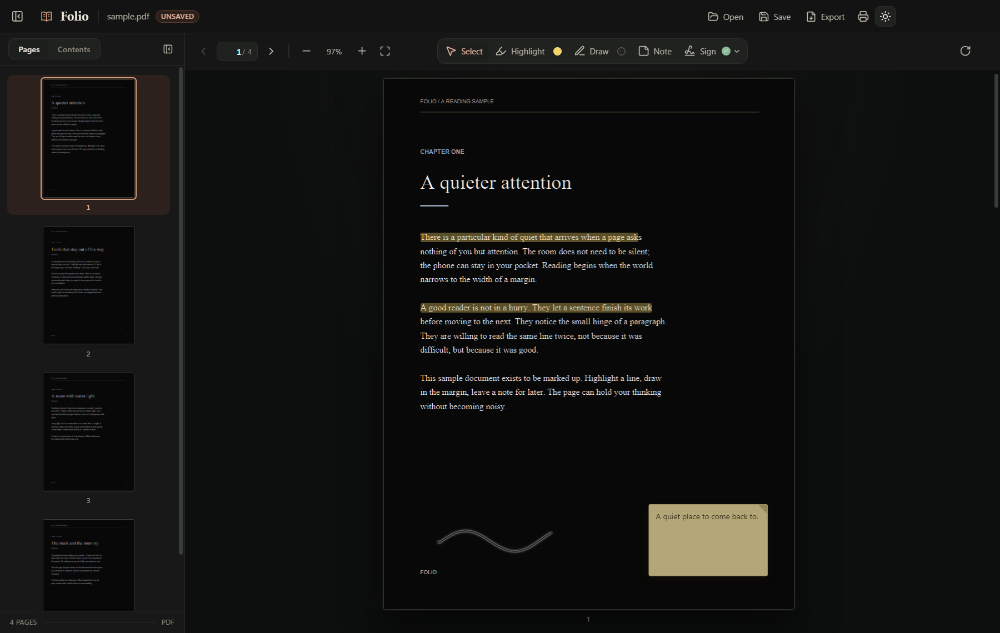
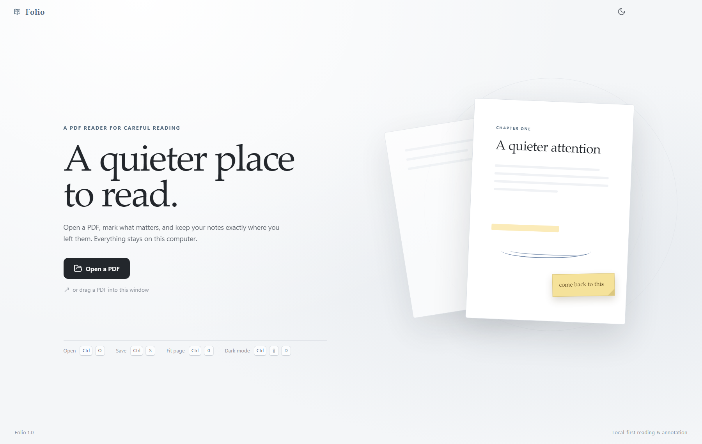

# Folio

Folio is a calm, focused Windows desktop PDF reader with real annotation tools. It is built with Electron, React, TypeScript, PDF.js, and pdf-lib.



<p align="center">
  
  
</p>

## What it does

- **Read** PDFs in a continuous, smoothly scrollable view with a page-level fit-to-window mode.
- **Navigate** by thumbnail, outline/bookmarks, previous/next controls, page number, or keyboard.
- **Annotate** with text highlights in six colors, freehand ink in six colors, movable/editable text notes, and reusable signatures.
- **Sign** by drawing, uploading an image, or capturing a photo from the computer's camera. Captured images can be flipped horizontally or vertically, have their paper background removed, and be trimmed before placement.
- **Move and resize** signatures with page-coordinate handles. Signatures and their images can be reused multiple times.
- **Save** everything into a self-contained `.folio` workspace, including the PDF, annotations, signature library, rotation, current page, zoom, and sidebar state.
- **Restore** the saved workspace by opening the `.folio` file later.
- **Export** a standard annotated PDF that opens in ordinary PDF readers. Highlights, ink, notes, and signatures are flattened into the document.
- **Print** the document with annotations intact.
- **Single-instance behavior** — opening another PDF from Explorer focuses the existing window and routes the file through the unsaved-changes prompt.
- **Read in the dark** with a true near-black reading surface: the rendered PDF page itself is darkened while annotations and signatures stay legible.
- **Stay protected** by an unsaved-changes prompt when closing or opening another document.

All processing is local. No document, signature, or camera frame leaves the computer.

## Requirements

- Windows 10 or Windows 11
- Node.js 20 LTS or newer (npm included)
- A webcam is optional; it is only used by the signature camera tab

## Run from source

```powershell
npm install
npm run build
npm start
```

`npm run build` copies the PDF.js font/CMap assets and compiles the Electron main process and the React renderer. `npm start` launches Folio after building.

For iterative development:

```powershell
npm run dev
```

This starts Vite with hot module replacement for the renderer and compiles the Electron main process in watch mode.

To create the Windows setup package:

```powershell
npm run dist
```

This produces:

- `release/Folio-1.1.0-Windows/` — ready-to-use extracted setup folder
- `release/Folio-1.1.0-Windows.zip` — shareable setup package

The setup is **script-based and deliberately avoids NSIS and Windows Installer**. Some Windows security configurations block NSIS/MSI installers from creating their temporary files or from running unsigned helper executables. This package only uses Windows Script Host and PowerShell, which do not need administrator access or an installer service.

The build is unsigned, so Windows SmartScreen may show an “unknown publisher” warning.

## Install on Windows

1. Extract `release/Folio-1.1.0-Windows.zip`.
2. Run **`Install Folio.cmd`** from the extracted folder.
3. Folio installs per-user in `%LOCALAPPDATA%\Programs\Folio`, creates Desktop and Start Menu shortcuts, and registers an optional “Open with” entry for `.pdf` and `.folio` files.

To run without installing, open `app\Folio.vbs` (or `app\Folio.cmd`) from the extracted folder.

To uninstall, use **Uninstall Folio** in the Start Menu Folio folder. Documents and reading workspaces are kept.

If McAfee or another security product blocks an extracted script, allow the extracted folder and `%LOCALAPPDATA%\Programs\Folio` in that product's trusted locations.

## Using Folio

1. Open a PDF with **Open** (`Ctrl+O`) or drag it into the window.
2. Use the sidebar for page thumbnails or the PDF's table of contents. Toggle it with the panel button or `Ctrl+B`.
3. Choose a tool from the center toolbar:
   - **Select** — select and move annotations, edit notes, resize/move signatures.
   - **Highlight** — drag over text. Open the color dot beside the tool for colors.
   - **Draw** — draw on the page. Open the dot beside the tool for pen color and size.
   - **Note** — click a page to place a note, then type. Double-click a note to edit it later.
   - **Sign** — draw/upload/photograph a signature, then click the page to place it. Keep the Sign tool active and click again to reuse the current signature; use the chevron to switch or manage the signature library.
4. Use **Save** (`Ctrl+S`) for a `.folio` workspace and **Export** (`Ctrl+Shift+E`) for a flattened PDF.
5. Use **Print** (`Ctrl+P`) to send the annotated pages to a printer. Print preparation shows page progress and can be canceled with **Esc** or the **Cancel** button.

Press **Esc** at any time to cancel the current action: it stops an in-progress stroke or annotation drag, clears a selection, closes dialogs, exits the active tool, cancels print preparation, or cancels a document that is still opening.

PDF text can be selected directly. Use `Ctrl+C` or right-click → **Copy** to copy it.

### Keyboard shortcuts

| Action | Shortcut |
| --- | --- |
| Open | `Ctrl+O` |
| Save workspace | `Ctrl+S` |
| Export annotated PDF | `Ctrl+Shift+E` |
| Print | `Ctrl+P` |
| Cancel the current action | `Esc` |
| Previous / next page | `←` / `→`, `PageUp` / `PageDown` |
| Zoom in / out | `Ctrl++` / `Ctrl+-` |
| Fit page | `Ctrl+0` |
| Toggle sidebar | `Ctrl+B` |
| Toggle dark reading | `Ctrl+Shift+D` |
| Select / highlight / draw / note / sign | `V` / `H` / `D` / `N` / `S` |
| Rotate clockwise | `R` |
| Delete selected annotation | `Delete` |
| Cancel tool / deselect | `Esc` |

## Architecture

```text
src/
  main/
    main.ts          Native window, file dialogs, save/export writes, printing,
                     camera permissions, close guard, developer test hooks
    preload.ts       Narrow context-isolated IPC bridge
  renderer/
    App.tsx          Application shell, drag/drop, keyboard shortcuts, print flow
    store.ts         Zustand document, view, selection, signature and dirty state
    pdf/
      pdfjs.ts       PDF.js loading, text-content cache, render helpers
      layout.ts      Virtualized page-stack geometry, scroll and anchor math
      geometry.ts    Screen <-> PDF coordinate transforms, including rotation
      outline.ts     Recursive PDF outline resolution
      workspace.ts   .folio serialization and validation
    annotations/
      types.ts       Annotation and signature types plus palettes
    components/
      PdfViewer.tsx  Virtualized page scroller, zoom anchoring, current-page tracking
      PdfPage.tsx    Lazy page rendering, PDF.js text layer, selection-to-highlight
      AnnotationLayer.tsx  Highlights, ink, notes, signature transforms, drag/resize
      Sidebar.tsx / ThumbnailPanel.tsx / OutlinePanel.tsx
      Toolbar.tsx / Titlebar.tsx / SelectionInspector.tsx
      PrintDeck.tsx  Hidden, page-accurate annotated print layout
    signatures/
      SignatureDialog.tsx / SignaturePad.tsx / CameraCapture.tsx / imageUtils.ts
    export/
      exportPdf.ts   pdf-lib flattening for highlight, ink, notes, signatures
```

Annotations are stored in **PDF user-space points**, not screen pixels. A rectangle is converted through the live PDF.js viewport at every zoom, fit, scroll, and rotation. This keeps every mark in the same place regardless of how the page is displayed. Notes and signatures are painted with an affine transform for rotated pages. Export writes those same PDF-space coordinates into a standard PDF with pdf-lib.

Saving uses a self-contained JSON `.folio` file. The original PDF bytes are base64-encoded inside it so a workspace can be moved to another computer without losing the document. The renderer retains a separate copy of the PDF bytes for export. The main process writes (and reads) that file by streaming the base64 payload, so a 40 MB book never has to be turned into one giant string on the UI thread.

### Large documents

Folio is designed to read books, so the reader is virtualized:

- Only the pages around the viewport exist in the DOM, and only those pages hold a canvas. Scroll position, page jumps and the current page are computed from the page geometry (`pdf/layout.ts`) instead of measured from the DOM, so scrolling costs one binary search per frame instead of one layout read per page.
- Zoom, rotation and page-size changes keep the reader anchored on the spot under the viewport instead of jumping. A repaint waits briefly for the gesture to settle and is composited from an offscreen bitmap, so pages never flash white while zooming.
- The text layer is built once per page at the page's natural scale and scaled with CSS, so it survives zooming without being rebuilt.
- Thumbnails are virtualized and rendered at thumbnail resolution; pages that scroll far out of view release their raster state.


## Testing

```powershell
npm run test:unit
npm run test:e2e
```

The unit suite covers PDF coordinate conversion, rotation, workspace serialization, and binary round-tripping.

The end-to-end suite launches the built Electron app with a workspace-local profile, a fake camera device, and automated save/export/print bridges. It exercises the acceptance workflow:

- drag and drop plus invalid-file handling
- outline and thumbnail navigation
- sidebar hide/restore
- zoom and fit
- highlight creation and recoloring
- freehand draw, selection, recolor, move
- note creation, movement, editing
- drawn, uploaded, and camera signatures
- signature placement, resize, move, and reuse
- annotation alignment across zoom
- dark reading mode
- rotation and printing
- save, export, restore, native-picker bridge
- unsaved-change prompts and save-on-close

Test artifacts and diagnostic screenshots are written beneath `tests/output/`.

The E2E harness uses Electron's remote debugging mode rather than the Playwright Electron launcher so it works in environments where Electron's Inspector startup is restricted. It starts the app with a temporary profile, drives the real renderer over CDP, and cleans up the process.

### Note for restricted Windows environments

Electron normally writes its profile to `%APPDATA%`. When running from source, Folio keeps its development profile in `.folio-dev-data/` inside the project, which also makes it work in locked-down testing environments. A packaged installation uses the standard per-user application data directory.

Folio's launchers first attempt to start the normal Electron sandbox. If Chromium's sandbox cannot initialize on a locked-down profile, they retry with software rendering and `--no-sandbox`. This fallback is what makes the portable/setup package work on Windows environments where the Electron sandbox is blocked.

## Third-party notices

- PDF.js — Apache-2.0
- pdf-lib — MIT
- Electron — MIT
- React — MIT
- Lucide — ISC

The bundled PDF.js standard fonts and CMaps retain their original licenses.
